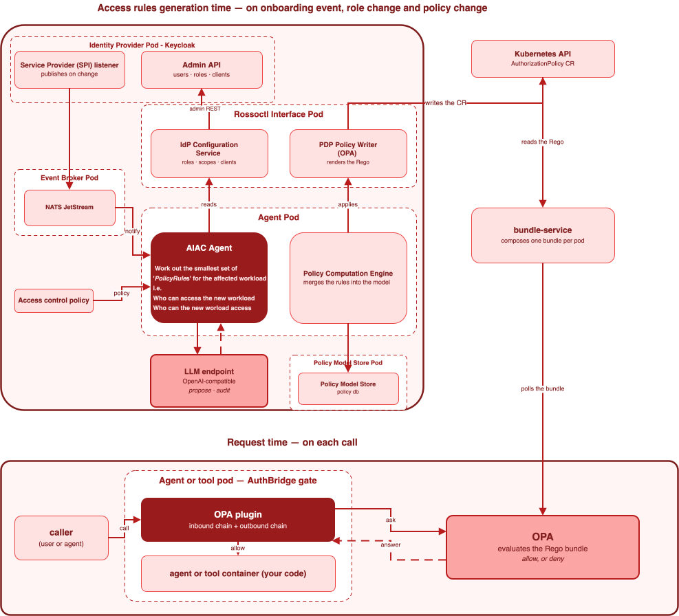

An access control policy in agentic systems states who may call what. You write that policy in plain language, for a person to read. A running agentic system needs that policy translated as access rules that a machine evaluates on each call. AI-based access control (AIAC) performs the translation. It generates the Rego rules that OPA evaluates,
and it repeats the work each time an agent or a tool is onboarded.

:::warning Alpha
This feature is an experiment. It lives in the separate repository
[rossoctl/aiac](https://github.com/rossoctl/aiac), and no Rossoctl installation contains it. It is off
by default. The behaviour, the interface and the set of deployed components will change. Evaluate it on
a test cluster.
:::

## The problem that it solves

An agentic system makes many calls. Follow one request from a user:

1. A user invokes an agent.
2. The agent invokes a tool.
3. The agent invokes a second agent.
4. The second agent invokes a tool.
5. The second agent invokes a second tool.

Each hop is a separate decision point to allow or to deny based on policy intent. Delegation makes
each agent two of those points: who may call the agent, and what the agent may do downstream
for that caller. See [Delegation](../core/identity.md#delegation).

The number of possible execution paths grows past the point where a person can list them. Your policy document also changes. Nobody keeps the two in agreement by hand.

Four problems follow:

- **The natural language form of the policy is far apart from the translated access rules.** A person writes a sentence. A gate evaluates Rego.
  A person performs that translation today, for each role and for each hop.
- **The rules fall behind the platform.** A new service or a new role arrives with no matching rule,
  because no mechanism applies one. The gap opens when you deploy the workload.
- **No single document states the intent.** The knowledge of what a role may do spreads over many
  deployments. You cannot read the intent in one place.
- **Each path needs a decision in advance.** A gate answers in milliseconds. It cannot read a policy
  document at the moment of the call.

## How it operates

AIAC separates three layers. Each layer has one component and one responsibility.

| Layer | Component | What it does |
| --- | --- | --- |
| Policy management | AIAC agent | Translates the policy in plain language into OPA rules. |
| Policy decision | OPA | Evaluates the rules. Decides what the caller may access. |
| Policy enforcement | [AuthBridge](../../security/authbridge.md) | Intercepts the call. Sends an access request to OPA. Allows or denies access. |



The diagram has two halves, and the split is the point. The upper half runs when something changes, and a
model runs there. The lower half runs on each call, and no model runs there.

AuthBridge wraps each workload that you secure with it — every agent and each tool, according to configuration. The
wrap gives that workload a gate on both directions of its traffic. AuthBridge runs a chain of plugins on
the inbound traffic, and a second chain on the outbound traffic. Each chain contains the OPA plugin. The
name of the plugin is [opa](https://github.com/rossoctl/cortex/blob/main/docs/plugin-catalog.md#opa).

That plugin decides nothing on its own. It asks OPA, and OPA answers from the Rego rules that AIAC wrote.
When a rule denies the call, the plugin returns the status 403 with this body:

```json
{"error":"policy.forbidden","message":"policy denied","plugin":"opa"}
```

### One rule set for each workload

AIAC writes one `AuthorizationPolicy` custom resource for each workload that it manages. An agent gets
one, and a tool gets one. Each resource holds two Rego packages: one for the inbound requests and one
for the outbound requests.

One setting, the enforcement side, selects which gate checks a call to a tool. The setting applies to
every workload.

| Enforcement side | Which gate checks a call to a tool | The resource of a tool |
| --- | --- | --- |
| Target side (default) | The inbound gate of the tool | Holds the check of each tool call |
| Agent side | The outbound gate of the calling agent | Allows each call |

Under both sides, the inbound gate of an agent checks who may call the agent.

Under target side, a tool call must pass two checks. The role of the user must grant the tool (according to the policy). The roles of the calling agent must also grant the tool (also according to the policy). A deny from either check stops the call.

### What starts a translation

| Event | What AIAC does |
| --- | --- |
| An operator registers a Keycloak client for an agent or a tool | Onboards the agent or the tool. Computes its rules, inbound and outbound. |
| An operator offboards a workload | Deletes the rules and the resource of the client. The global policy then denies its pod. |
| A user or an agent gets or loses a realm role | Writes again each resource that uses the role, with the current holders. |

For an onboarding, the agent performs these steps:

1. It receives the event from the event broker. The broker stores each event and delivers it again
   after a failure, so a restart of the agent loses no stored event.
2. It runs the precondition checks. If the pod of the workload cannot enforce a resource, the onboarding
   stops with the status 409, and nothing changes.
3. It reads the roles, the agent and tool ids and the scopes from Keycloak, with the description of
   each role. It also reads the capabilities of the agent or the tool.
4. It reads the whole policy, not only the part that applies to the event.
5. A model proposes the rules. A second pass of the model audits them against the policy.
6. The computation engine merges the proposed rules into the policy model that the store holds.
7. The policy writer renders the merged model as Rego into the `AuthorizationPolicy` resources.
8. `bundle-service` composes those resources into one bundle for each pod. The OPA plugin polls that
   bundle.

If an onboarding fails, AIAC quarantines the workload. It removes the roles and the scopes that the
onboarding created, and it disables the Keycloak client. It deletes the resource of the workload, so the
global policy denies the pod. Only a successful onboarding removes the quarantine.

AIAC reports a conflict. It never resolves one. A role and a scope that carry both a grant and a
prohibition stop the request with the status 422 and a report of every conflict found. No rule changes.
This behaviour has no exception. AIAC applies no precedence and performs no merge, because a conflict is
a fault in the policy that a person must correct.

## Every decision happens before the call

AIAC calls a model when the platform changes. No model runs when a call arrives. The agent reasons
over each potential interaction on each potential execution path. It writes the result as Rego, as
constraint rules that OPA evaluates later.

Two results follow. AIAC adds nothing to the response time of a request, because OPA evaluates a rule and
calls no model. And you pay for a model on each onboarding, not on each call of an agent.

Your policy is the ground truth for each rule. A second pass of the model audits each proposed rule
against the policy file that the agent read.

## How to enable it

You need these items:

- A Kubernetes cluster with Keycloak and the Rossoctl operator.
- The OPA plugin in both the inbound chain and the outbound chain of AuthBridge, for each agent and each
  tool.
- The bundle service, with the changed global policy of AIAC. That policy denies a pod that has no
  resource. AIAC checks for it at each start, and it does not start without it.
- An endpoint that is compatible with the OpenAI chat interface. AIAC calls that endpoint for each
  translation.

Apply the OPA plugin and the changed global policy before you install AIAC. The script
`k8s/opa-kind-enable.sh` in the AIAC repository does both on a Kind cluster.

AIAC deploys into its own namespace, `aiac-system`, from the manifests in its own repository. For the
build of each image, the two Secrets, and the order to apply the manifests, follow the
[AIAC installation guide](https://github.com/rossoctl/aiac/blob/main/k8s/aiac-deployment-guide.md).

Those manifests deploy four components: the interface pod, the event broker, the policy model store and
the agent.

The enforcement side is `target-side` by default. To use agent side, set `AIAC_ENFORCEMENT_SIDE` to
`agent-side` in the `aiac-agent-config` ConfigMap before you deploy. You cannot change the side on a
running installation. To change it, remove AIAC and deploy it again, then onboard each workload again.

## What it does not do

- **It enforces nothing.** AuthBridge intercepts each call, and OPA decides it. AIAC writes the rules
  only.
- **It does not create users or assign roles.** Keycloak keeps the users and their roles. AIAC writes
  the current holders of each role into the rules, and it writes them again when a holder changes. A
  role that a user gets through a group does not count.
- **It does not update the rules when your policy changes.** The routes to build the rules again from a
  changed policy exist, but they compute no rule. To apply a changed policy, onboard each workload again.
- **It does not update the rules when the definition of a role changes.** That handler computes no rule.
- **It does not offboard a workload when Keycloak removes its client.** An operator must call the
  offboard route.
- **It does not resolve a conflict.** It reports each conflict and changes no rule.
- **It does not record the reason for a rule.** A rule holds a role, a scope and an effect. AIAC stores
  no reference to the sentence of the policy that justifies it.
- **It does not review the rules that a person added.** A review of the current entitlements, and a
  request for access from a user, are both planned. Neither one is present.
- **It does not replace the identity of a workload.** Keycloak remains the identity provider, and the
  platform continues to register each agent and each tool as a client.

## Try it

The [AIAC onboarding demonstration](https://github.com/rossoctl/aiac/blob/main/demo/use-cases/onboarding/demo.md)
deploys a GitHub agent and a GitHub tool, and gives AIAC a policy of two lines. The deployment of the two
workloads starts the onboarding. No person runs an onboarding command. The demonstration then sends real
requests through the OPA plugin, and shows which ones OPA allows and which ones it denies.

## Related pages

- [Identity and trust](../core/identity.md) describes how the identity of a workload becomes access, and
  where roles come from.
- [AuthBridge](../../security/authbridge.md) describes the layer that enforces the decision of OPA, and
  the path of one request.
- [Intent-based access](intent-based-access.md) asks a model about one action, at the moment of that
  action. This feature decides each action in advance, and calls no model on the path of a request.
